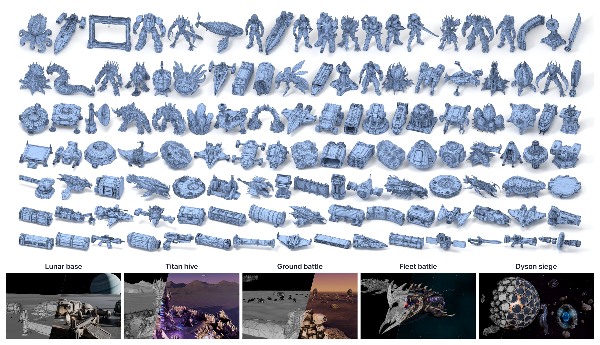

<div align="center">

# MeshAxiom: An Agent-Native 3D Foundation Stack for Programmable Worlds

**[AlayaLab](https://github.com/AlayaLab)**

[](https://huggingface.co/AlayaLab/MeshAxiom-Base)
[](https://github.com/AlayaLab/MeshAxiom)
[](https://alaya-lab.github.io/MeshAxiom/)
[](https://alaya-lab.github.io/MeshAxiom/space-kit.html)

**Compact meshes. Explicit topology. Editable worlds.**



</div>

## Overview

MeshAxiom connects compact, explicit 3D meshes to persistent asset records and programmable scene state. **MeshAxiom-Base** turns a single image and a requested face budget into a native triangle mesh. File-based tools let programs and agents inspect and revise these assets, reuse them as modules, and control scene transforms, motion and cameras.

This is the official repository for the MeshAxiom model and workflow. The project website and interactive asset library are available now; Exact inference code is included below as a release candidate. Model weights are hosted in the [MeshAxiom-Base repository on Hugging Face](https://huggingface.co/AlayaLab/MeshAxiom-Base); the paper and remaining workflow tools will follow.

## Agent-Native 3D Authoring

Agent-native describes the interface: agents call tools on asset files, receive compact summaries and rendered views, and retain geometry and generation recipes for later operations. Compact geometry and explicit triangle connectivity provide objects that geometric code and scene programs can read and edit.

MeshAxiom-Base generates vertices coarse to fine with a diffusion transformer over a sparse octree, then predicts connectivity with a second diffusion transformer in the latent space of a topology autoencoder. The requested face budget conditions generation; realized counts can differ from the request.

## From Meshes to Worlds

The authoring workflow carries generated geometry into ordinary 3D tools:

1. **Generate meshes:** create compact geometry with explicit vertices and triangle faces.
2. **Assemble scenes:** arrange assets and parts in an editable 3D scene.
3. **Author materials and motion:** add UVs, materials, rigs, part transforms and animation.
4. **Render the scene:** define cameras, lighting and effects to produce geometry and material control videos.

A video-generation model can use a control video as a soft condition for an additional appearance stage. The base model generates mesh geometry and connectivity; UVs, materials, rigs, scene assembly and choreography belong to the authoring workflow.

## Explore Space Saga

**[Space Saga](https://alaya-lab.github.io/MeshAxiom/#saga)** showcases twelve scenes built from the space asset kit, including stations, fleets, shipyards, moon bases and alien encounters. Compare **Materials** with **Gray mesh** or **Topology** on the same scene timeline.

The twelve scenes use generated meshes in explicit scene programs. Bounded mesh repairs and external material refinement belong to the authoring workflow, separate from raw-model measurements.

The **[3D asset library](https://alaya-lab.github.io/MeshAxiom/space-kit.html)** contains **123 assets**, with input-image, gray-mesh, topology and material views, interactive 3D inspection and original GLB downloads. Explore modular assemblies and scenes built from the kit, with **Materials**, **Gray mesh** and **Topology** comparisons.

## Release Status

- [x] Project website and Space Saga showcase
- [x] Interactive 3D asset library and asset downloads
- [x] MeshAxiom-Base Exact inference code (release candidate)
- [x] Model weights on Hugging Face (access required)
- [ ] MeshAxiom workflow and tools
- [ ] Paper and workflow documentation

The code includes CLI, Python, agent and local upload interfaces, with separate material tools. The Hugging Face model repository currently requires access. The Base recipe uses vertex EMA 100K, topology EMA 10K and VAE EMA 30K. Version `0.2.0.dev2` passes 95 CPU tests and a bounded H200 check: reference and Exact produce identical geometry files for one image at 4K and 8K requests, including resident worker reuse. See [validation](VALIDATION.json). The authors' license assignment remains pending.


## Install

Use Linux with CUDA. The author-tested acceleration stack is NVIDIA PyTorch
25.03, CUDA 12.8, Python 3.12 and H200. Other environments require verification
with `verify-exact`. Install into an isolated environment:

```bash
python -m pip install -e '.[geometry,hub,background,postprocess]'
```

The NGC container already supplies PyTorch. `deploy/huggingface/space/Dockerfile`
records the deployment stack; its cold build and target hardware must be tested.

## Load the model

The Hugging Face model payload is prepared separately from this code repository.
It contains `meshaxiom.json`, three EMA files under `weights/`, and the local
DINOv3 architecture/processor configuration. No extra DINOv3 model download is
needed: the released EMA files already contain those backbone tensors.

For a local model directory:

```python
from meshaxiom import MeshAxiomPipeline

with MeshAxiomPipeline.from_pretrained("models/MeshAxiom-Base") as pipeline:
    result = pipeline.generate("image.png", "outputs/object", face_budget=4000)
    print(result["artifacts"]["obj"]["path"])
```

Authenticate with an authorized Hugging Face account, then load the Hub repository `AlayaLab/MeshAxiom-Base` at the verified model revision:

```python
with MeshAxiomPipeline.from_pretrained(
    "AlayaLab/MeshAxiom-Base",
    revision="25a6250fc88e2438e5a666ad8622c3475f64e6b0",
) as pipeline:
    first = pipeline.generate("first.png", "outputs/first", face_budget=4000)
    second = pipeline.generate("second.png", "outputs/second", face_budget=8000)
```

The two model workers remain resident between calls. `close()` or the `with`
statement releases them and their cooperative GPU lease. Face requests guide
native generation; actual face counts can differ. Requests of 2K, 4K, 8K and 16K
are useful examples, rather than enforced triangle counts.

## CLI and upload UI

```bash
meshaxiom doctor --config models/MeshAxiom-Base/meshaxiom.json --operation geometry --verify-hashes --runtime-check
meshaxiom generate --config models/MeshAxiom-Base/meshaxiom.json --image image.png --face-budget 4000 --output outputs/object
meshaxiom serve --config models/MeshAxiom-Base/meshaxiom.json --workspace outputs/server
```

Open `http://127.0.0.1:7860` for the local upload page. The first generation loads
the models; later generations reuse them. For an already prepared 512×512
RGB-on-black input, use `--background keep`. Transparent PNGs can use
`--background alpha`; ordinary photographs use `auto` or `remove` with the
background extra. Both stages receive the same prepared image and processor tensor.

Geometry outputs are `mesh.obj`, `mesh.json`, `mesh.glb`, `vertices.npz` and
`topology.npz`, accompanied by input, checkpoint and geometry reports. OBJ/JSON
use Z-up coordinates; the GLB has an explicit transform into glTF's Y-up frame.

## Verify Exact on the target machine

```bash
meshaxiom verify-exact --config models/MeshAxiom-Base/meshaxiom.json \
  --image examples/reference.png --background keep --face-budget 4000 \
  --output outputs/identity-4k
```

This diagnostic runs the packaged reference and Exact implementations separately
and requires equal SHA256 for `vertices.npz`, `topology.npz`, `mesh.obj` and
`mesh.json`. A mismatch returns a failure and retains both outputs. The reference
is used only for verification. Identity is specific to the tested inputs, weights,
GPU and software stack. See [Exact implementation](docs/EXACT.md).

## Agents and material tools

[Agent usage](docs/AGENT_USAGE.md) describes JSON calls and the local HTTP API.
[Materials](docs/MATERIALS.md) covers `texture_mesh` for an existing mesh and
`enhance_texture` for independent texture enhancement. These do not require
loading the Base geometry model.

## Release preparation

[Hugging Face deployment](docs/HUGGINGFACE.md) describes the model payload and
Docker Space. [Release status](docs/RELEASE_PREPARATION.md) records the remaining
validation and license details for this source release candidate. The
[MeshAxiom-Base model repository](https://huggingface.co/AlayaLab/MeshAxiom-Base)
currently requires access. A hosted Space is not available yet.

Sho Kuno provided the Exact inference acceleration. Third-party notices and
DINOv3 terms are retained; see [licenses and dependencies](docs/THIRD_PARTY.md).
